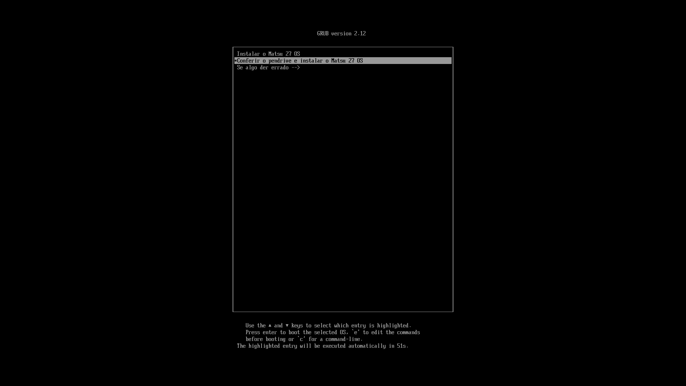
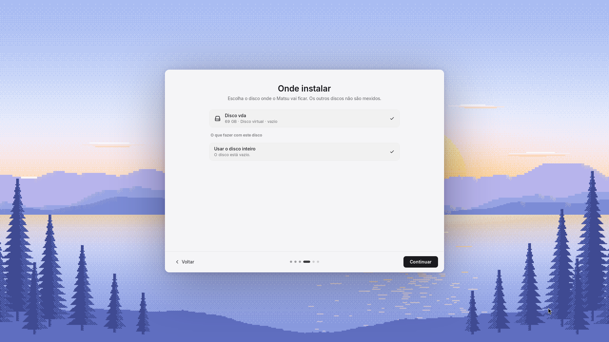
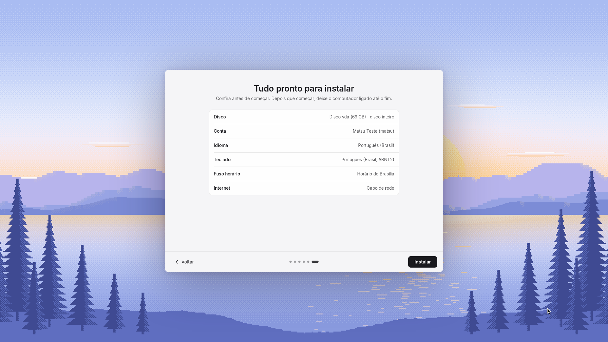
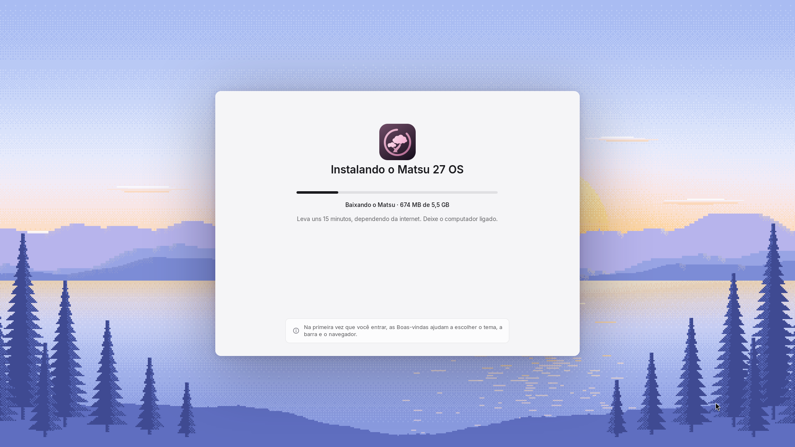
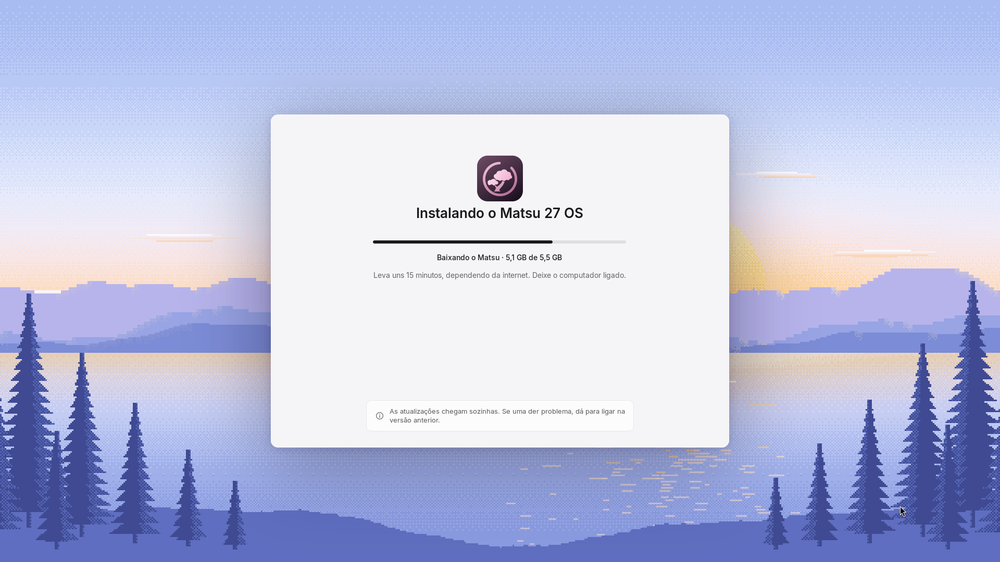
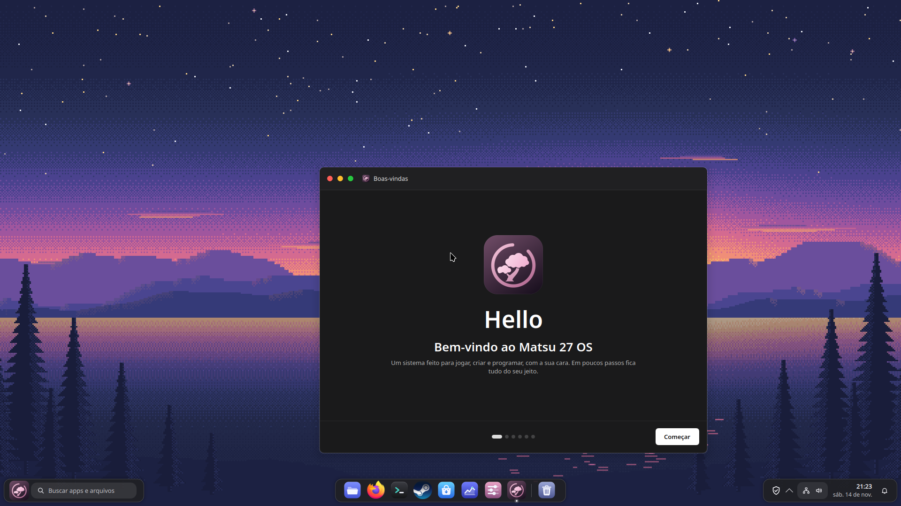

# Prints do instalador

ISO: `matsu-os-27-amd.iso` · commit a962ea6 · 15/11/2026 00:23 UTC

### 01-menu-de-boot

### 02-ola

### 03-idioma

### 04-internet

### 05-disco

### 06-conta-vazia

### 07-conta

### 08-resumo

### 09-instalando

### 10-instalando-1

### 11-pronto

### 12-sistema-instalado

### 13-primeiro-login

